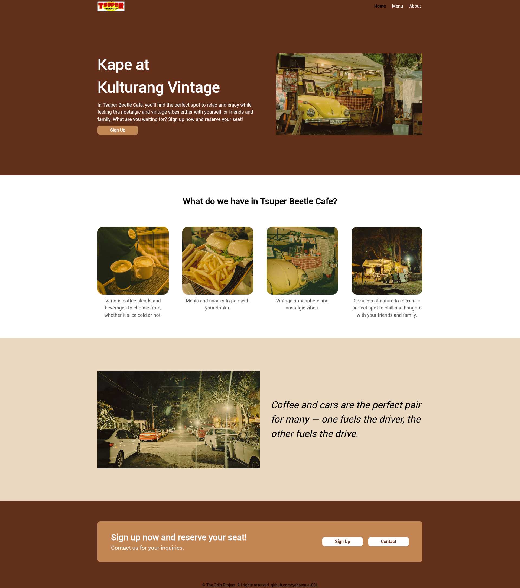
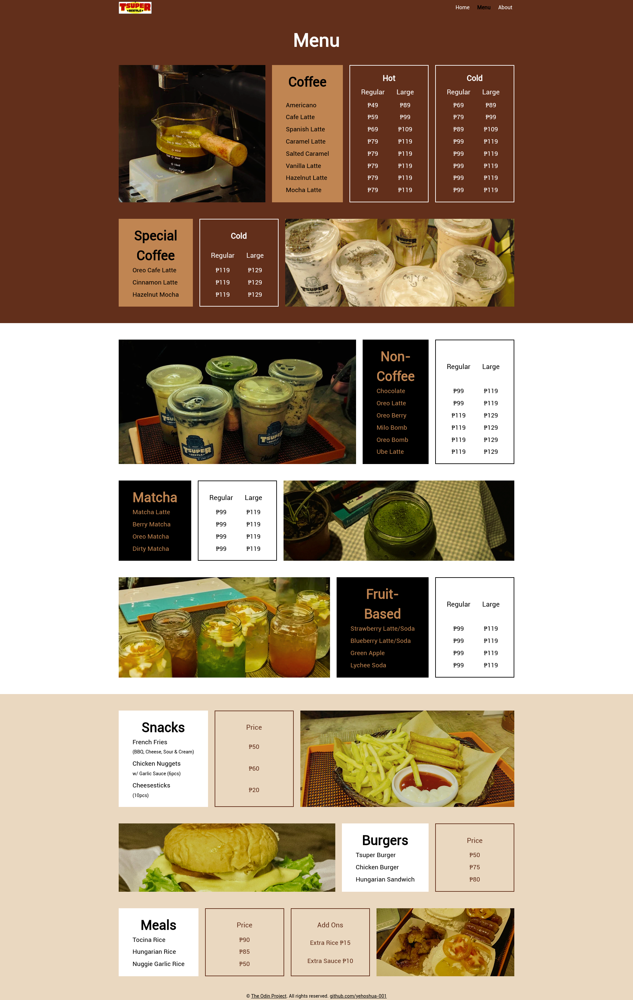
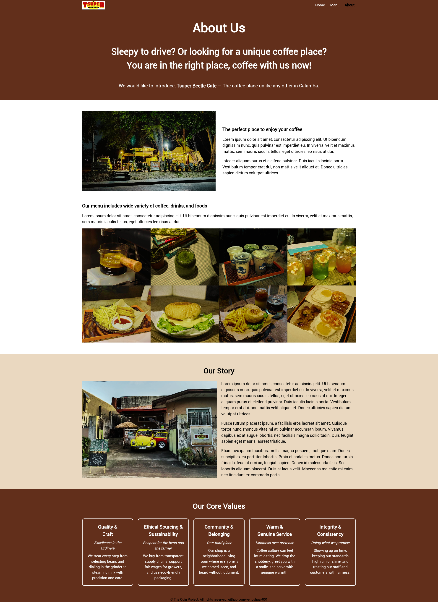

# Project: Restaurant Page | The Odin Project

## Description
This project is a web-based restaurant site that features "page-switching website" using JavaScript (ES6) Modules. The purpose of this project is to demonstrate and practice the lessons I learned in ES6 Modules, npm, and Webpack in [JavaScript Course](https://www.theodinproject.com/paths/full-stack-javascript/courses/javascript#organizing-your-javascript-code).

<strong>Disclaimer</strong>: I based this project on an actual business which owns by relatives of mine.

## Demo

## Sample Images

## Setup
Method 1
- github-page: https://yehoshua-001.github.io/restaurant-page/

Method 2
1. Install the package via npm: `npm install github:yehoshua-001/restaurant-page`.
2. The package is save in node_modules directory of npm by default, e.g: *node_modules/restaurant-page*.
3. Open the directory *restaurant-page* in VSCode and run `npm install -D webpack-cli` in the terminal of directory.
4. A. Run `npx webpack` and open the *dist* folder and open the **index.html** in your browser .
B. Alternatively, you can open it through your localhost, in this case make sure you installed the **webpack dev server** via npm: 
`npm install --save-dev webpack-dev-server` (source map is added by default in webpack.config.js) .
B.1. Run `npx webpack serve` then open your localhost, it is http://localhost:8080/ by default 
but you can check the output of the recent command and look for the **Loopback**.

